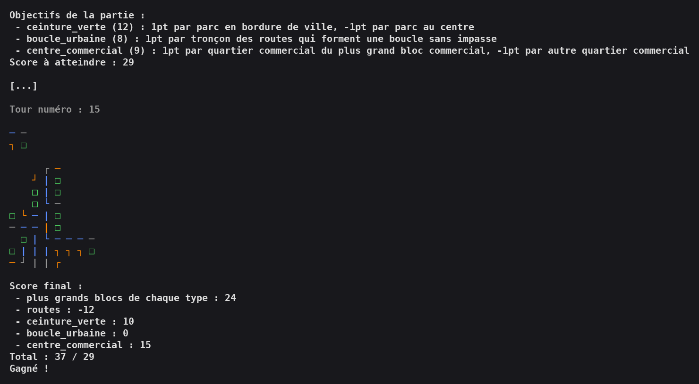

# Megalopolis

A card-based city-building game played in the terminal, written in functional-style TypeScript: tiles made of four city districts are laid down one by one to grow a city, then the city is scored on its districts, its roads and a set of random objectives.

School project at ENSEIRB-MATMECA (March–April 2024), developed by a team of four students (see [Authors](#authors)).



## Rules in brief

- Each tile is a 2x2 card of districts: residential (orange), commercial (blue), park (green) and industrial (gray). Every non-park district is crossed by a road section.
- A game uses a deck of 15 tiles and 3 objective cards drawn at random among 11. The score to reach is the sum of the values of the 3 objective cards.
- Each turn, the top tile of the deck is placed on the board, possibly flipped by 180°. It must touch or partially overlap the city, and may not completely cover a tile already in place.
- When the deck is empty, the city is scored:
  - **blocks**: +1 point per district in the largest block (group of connected districts) of each type;
  - **roads**: -1 point per road (a road is a chain of connected road sections);
  - **objectives**: the points given by each of the 3 objectives (dead ends, park belts, longest road, closed loops, mixed rows and columns...).
- The game is won if the final score reaches the target.

The objective cards and their rules are listed in [`cards.yaml`](cards.yaml) (rules written in French).

## Features

- Full game loop: objective draw, random deck, 15 turns, final score breakdown and win/loss.
- Automatic player: for each tile, every valid position and both orientations are tried, and the placement giving the best score is kept (`playBestTile`). A purely random player is also available (`playTile`).
- Sparse board stored as a key/value dictionary indexed by position; only the occupied bounding box is displayed.
- Colored terminal rendering with ANSI colors and box-drawing characters for roads.
- Scoring engine: blocks and roads are computed as connected components of an adjacency-list graph (depth-first search), plus 11 objective calculators.
- Immutable data structures: board, tile stack (deck) and graph functions never modify their arguments.
- Jest test suite covering the graph, the placement rules, the scoring of blocks and roads, every objective and the objective selection.

## Tech stack

- TypeScript 6 (ES modules), Node.js 20+
- Jest 30 + ts-jest
- ESLint 10 with typescript-eslint

## Getting started

Prerequisites: Node.js 20.19 or later and npm.

```bash
npm ci            # install dependencies
npm run build     # compile src/ to dist/
npm run main      # play a full game in the terminal
npm test          # run the Jest test suite
npm run eslint    # lint src/ and tst/
```

The `Makefile` provides the same targets (`make build`, `make run`, `make test`, `make eslint`).

## Project structure

```
src/
  world.ts       tiles, districts, board, placement rules and terminal display
  play.ts        random and best-score placement of a tile
  stack.ts       tile stack (deck)
  graph.ts       adjacency-list graph and connected components
  objectives.ts  objective cards, random selection and score to reach
  score.ts       blocks, roads and objective scoring
  main.ts        game loop
tst/             Jest tests
cards.yaml       objective cards and their scoring rules
```

## Credits

The initial project skeleton (build, lint and test configuration, directory layout) was provided by the school as a starting point.

## Authors

Arthur Dufetrelle, together with three fellow ENSEIRB-MATMECA students.
